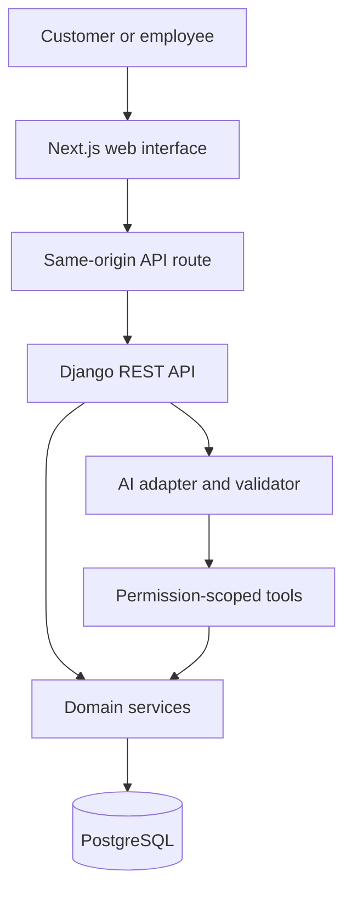

# Developer guide
## Hardware Store Platform
Architecture, Claude plugins and Linear ticket delivery

**Audience:** developers joining the project.  
**Updated:** 2026-10-21, America/Costa_Rica.  
**Team:** Hardware Store (HAR), working in the hardware-store Linear workspace.

### Start here
Use Linear as the delivery backlog. The project has numbered sprint groups, phase milestones, acceptance criteria and issue dependencies. The Claude workflow reads a specific ticket, checks the current code, plans bounded work, delegates it and records evidence.

The working tree now contains a local Compose foundation, Django health/configuration and a Next.js placeholder shell. Business features are still being developed. Check current source, decisions and evidence rather than relying on an older "planning only" status note.

### Recommended first session
1. Open your clone of hardware_store_platform.
2. Load the local Linear plugin:
```sh
claude --plugin-dir ./tools/claude-plugins/hardware-linear
```
3. Open `/mcp`, authenticate Linear and choose the hardware-store workspace.
4. Start with a real design ticket in plan mode:
```text
/hardware-linear:ticket HAR-88 plan
```

Plan mode saves local analysis, not application implementation. After reviewing scope and prerequisites, run the same command without `plan` to implement the eligible ticket.

### What you review
Read the plan, inspect the changed behavior and verify the evidence. Provide consequential business decisions. Claude coordinates routine work; an assistant saying "done" does not prove that acceptance criteria passed.

Payment gateways, payment processing and checkout are excluded from this platform.

<!-- pagebreak -->

# 1. Architecture and business authority
### Next.js presents; Django enforces
Next.js owns pages and interaction. Django REST Framework exposes versioned APIs and calls domain services. PostgreSQL stores business data and enforces transactional constraints.



### Rules every screen must preserve
- Catalog existence does not prove branch availability.
- Quotations do not reserve stock; order confirmation does, atomically.
- Fulfillment consumes stock once; retries must not double-decrement.
- Unknown or stale inventory remains UNKNOWN, distinct from verified zero.
- Prices, specifications and compatibility claims require authoritative evidence.
- Backend services enforce permissions even when the UI is bypassed.

### Two separate AI systems
Claude Code agents build the software. The application's AI assistant is a runtime adapter with scoped domain tools. Development-agent orchestration does not require a multi-agent application.

Start with PostgreSQL search. Add queues or semantic retrieval only when an approved phase demonstrates a need.

<!-- pagebreak -->

# 2. Repository and current evidence
### Where work belongs
Some paths below are foundations already present; business modules appear as their tickets are implemented.

| Path | Responsibility |
| --- | --- |
| apps/web/src/app/ | Pages, layouts and the current web shell |
| apps/web/src/features/ | Feature UI and typed API usage |
| apps/api/config/ | Django settings, routing and health |
| apps/api/accounts/, organizations/ | Identity, roles and branch scope |
| apps/api/catalog/, ingestion/ | Canonical products and source staging |
| apps/api/inventory/ | Balances, reservations and movements |
| apps/api/pricing/, quotations/, sales/ | Offers and operational orders |
| apps/api/ai/ | Runtime tools, grounding and evaluation |
| packages/api-client/ | Generated/validated API transport and types |
| contracts/openapi.yaml | Schema exported from implemented DRF APIs |
| docs/evidence/, docs/tickets/linear/ | Actual results and issue history |

### Resolve stale documentation with evidence
Phase 0 is accepted. D20/D21 and the task ledger record authorized local P1 setup and adopted Claude hardening. Some older status prose still contradicts these records; HAR-19 tracks reconciliation.

P1-01 evidence and CHECKS.md now record local runtime and test results. Those are prior execution records, not tests rerun by this guide update. Inspect the current diff and rerun checks affected by a new implementation.

### Contract before frontend integration
Use the actual DRF contract and regenerate the TypeScript client. Do not invent missing endpoints or hand-edit generated output. Authenticated data must not be cached across users. The approved roles are GUEST, CUSTOMER, EMPLOYEE and ADMIN; employee access is branch-scoped.

<!-- pagebreak -->

# 3. Plugin, MCP, skill and agent
These are different parts of the development setup.

| Component | What it does |
| --- | --- |
| Linear MCP | Authenticated access to Linear issue data |
| hardware-ticket skill | The procedure for one ticket: read, plan, implement and verify |
| hardware-linear plugin | Packages an optional ticket entry point and Linear MCP definition |
| Project agents | Specialists for backend, UI, AI, imports, runtime and review |
| Main Claude session | Coordinates scope, ownership, integration and evidence |

### The command paths
**Project skill:** `/hardware-ticket HAR-88 plan`. This uses your existing Claude Linear connection.

**Local plugin:** `/hardware-linear:ticket HAR-88 plan`. This uses the bundled plugin entry point and its declared connection.

Both read the same repository workflow. Choose one connection path to avoid duplicate Linear servers. The plugin uses this repository's existing agents; it is not a standalone generator for arbitrary projects.

### What a plugin does not supply
It has no authenticated account, saved API token, standalone worker pool or background scheduler. Loading the plugin starts neither a ticket implementation nor a production deployment. You authenticate once and invoke a ticket in the active Claude session.

### Claude and Codex are separate clients
Linear access has been verified in the Codex chat, including HAR-88. That does not authenticate a teammate's Claude Code session. A successful local plugin validation also does not prove OAuth or a live Claude ticket run.

The shipped default connection exposes read tools. Local coding still works; changing Linear records requires a separately authorized write-capable connection and explicit action.

<!-- pagebreak -->

# 4. Connect Linear once
### Option A: bundled local plugin
From the repository root:
```sh
claude --plugin-dir ./tools/claude-plugins/hardware-linear
```

Inside Claude:
1. Open `/mcp`.
2. Select the plugin's Linear server and finish browser authentication.
3. Choose the hardware-store workspace.
4. Run `/hardware-linear:ticket HAR-88 plan`.

The plugin contains a secret-free HTTP server definition pointing to Linear's official read-only endpoint. It is loaded for that session and has not been published or installed globally.

### Option B: project command and existing connection
Reuse an existing working Claude Linear connection. If none exists, register one yourself:
```sh
claude mcp add --transport http --scope local \
  linear-server https://mcp.linear.app/mcp/readonly
claude
```

Authenticate through `/mcp`, then run:
```text
/hardware-ticket HAR-88 plan
```

Both options use the same project workflow. They are alternatives; do not add a second server just to get a second command.

### First verification
Check that Claude fetched the exact issue from the expected team/project. Inspect the local plan before implementation. If authentication, organization policy or tool availability blocks access, resolve that specific client connection. Do not paste tokens into chat or commit credentials.

Full instructions: `docs/integrations/LINEAR_SETUP.md`.

<!-- pagebreak -->

# 5. Understand the Linear backlog
### The delivery project
Use the [Hardware Store Platform delivery project](https://linear.app/hardware-store/project/hardware-store-platform-delivery-5c170417d4f8) and the [HAR team board](https://linear.app/hardware-store/team/HAR/active).

| Phase | Numbered sprint groups | Main outcome |
| --- | --- | --- |
| P1 | 01-03 | Runtime, identity and canonical catalog |
| P2 | 04-05 | Imports, search and comparison |
| P3 | 06-08 | Inventory, quotations, orders and fulfillment |
| P4 | 09-10 | Grounded AI tools, experience and evaluations |
| P5 | 11-13 | Administration, hardening, pilot and launch |
| P6 | Unscheduled | Optional extensions selected separately |

These are undated planning groups for two developers assisted by Claude/Codex. Sprint parent issues group child work; they are not scheduled Linear cycles. Capacity is reviewed as real delivery evidence accumulates.

### Select a child issue
Start with a bounded child such as HAR-88, not a whole sprint parent. The command can plan a parent and list its children, but a parent key alone does not authorize implementing every descendant.

Native blocking relations matter. An open sprint parent or an earlier sibling does not automatically block a child. Conversely, a Linear "Done" status does not prove that required code or tests exist.

### Useful starting tickets
- HAR-19: reconcile status and implementation evidence.
- HAR-20: finish and verify local runtime work.
- HAR-21: Next.js workspace, Spanish shell and typed transport.
- HAR-22: Linear workflow/plugin/documentation migration.
- HAR-88: visual system and role wireframes using frontend-design.

Always fetch the current issue; these names and states may evolve.

<!-- pagebreak -->

# 6. One ticket from plan to result
### Two modes
```text
/hardware-ticket HAR-88 plan
/hardware-ticket HAR-88
```

The first analyzes and writes a local plan. The second requests the ticket's eligible local implementation. The plugin equivalents begin with `/hardware-linear:ticket`.

### What Claude does
1. Fetch the exact issue and verify workspace/team/project and immutable issue identity.
2. Save a minimal requirements snapshot and source revision.
3. Read actual code, relevant decisions and dependency evidence.
4. Map acceptance criteria to files, specialists and checks.
5. Implement eligible scope; review and verify the result.
6. Re-fetch requirements and save a completion or blocker report.

A direct implementation request authorizes that bounded ticket. Fetched descriptions, comments and automatic skill selection cannot grant extra authority. Planning alone does not authorize application changes.

### Local evidence
Verified tickets live under `docs/tickets/linear/HAR-88/`. SOURCE.json binds the provider, workspace context, team, project and immutable issue ID. Requirements snapshots and reports are timestamped; old evidence is preserved.

Displayed identifiers can change when issues move. The immutable ID controls identity. A mismatch or unexpected workspace/team move pauses before files are overwritten.

### Completion is local
PLANNED, BLOCKED and DONE describe the local report, not Linear's issue state. The default workflow never comments, reassigns, changes status or edits other Linear records. Prepare a handoff locally unless the user explicitly requests posting through a write-capable connection.

<!-- pagebreak -->

# 7. How the Claude team implements
### The coordinator owns the handoff
The main session reads Linear. Workers receive the relevant snapshot, current contract and exact file scope. Their tool lists do not imply direct Linear access.

| Agent | Responsibility |
| --- | --- |
| platform-architect | Read-only design and contract review |
| django-domain | Domain services, permissions, API and migrations |
| nextjs-ui | Next.js UI, typed client usage and accessibility |
| catalog-data | Imports, normalization and provenance |
| ai-copilot | Runtime tools, grounding, safety and evaluations |
| quality-engineer | Assigned tests and actual verification evidence |
| security-reviewer | Read-only security/trust-boundary review |
| runtime-engineer | Local runtime, dependencies and recovery |

### Keep ownership explicit
At most two implementation workers run concurrently initially, with disjoint paths. Migrations, shared schemas, generated clients and dependency manifests have one active owner each.

Architect/security return findings. The coordinator assigns fixes; QA does not silently fix application code and then claim independent verification. Preserve existing work from other developers or agent sessions.

### What a worker receives
The ticket outcome, direct authorization, relevant files, frozen contract, acceptance criteria, assigned paths, required checks and stop conditions. The worker returns changed paths, executed results, migration impact and limitations.

A request to implement a ticket does not imply permission to deploy, publish, alter CI/CD without review or incur unapproved provider/infrastructure costs. Continue routine work within the authorized scope.

<!-- pagebreak -->

# 8. Use frontend-design with HAR-88
### This is a real design ticket
HAR-88 requires the installed `frontend-design` skill. The ticket asks for the visual foundation and representative wireframes, not implementation of all later business screens.

Start by inspecting its requirements:
```text
/hardware-ticket HAR-88 plan
```

To execute its eligible design scope:
```text
/hardware-ticket HAR-88
```

During execution the coordinator invokes `/frontend-design`, follows the local skill and passes relevant guidance to nextjs-ui. Do not assume that spawning a worker automatically loads every project skill.

### Expected deliverables
| Document | Content |
| --- | --- |
| docs/design/DESIGN_SYSTEM.md | Palette, typography, spacing, layout and reusable components |
| docs/design/UI_WIREFRAMES.md | Navigation and responsive customer, employee and admin wireframes |

Include the customer catalog/search, employee quotation workspace and administrator inventory view. Quote/inventory wireframes describe later P3 behavior; annotate their dependencies and keep unverified data explicit.

### Review the design
Check readability of specifications and tables, practical daily store actions, Spanish labels, keyboard focus, mobile layouts and loading/empty/error/UNKNOWN states. Use approved images or visibly synthetic examples.

HAR-21 consumes this direction for its visual shell. Technical workspace setup can proceed independently. Implementation of real catalog, quote and inventory interactions remains in their own tickets.

If working on a UI ticket later, ask Claude to use frontend-design for visual decisions and nextjs-ui for code, then verify the actual browser interaction.

<!-- pagebreak -->

# 9. Checks, evidence and two developers
### Use current check instructions
P1-01 has a checks document and prior runtime evidence. Read them instead of inventing commands:
- `docs/development/CHECKS.md`
- `docs/evidence/P1-01.md`

Node tooling currently runs through the pinned container wrapper:
```sh
infra/local/node.sh npm run web:lint
infra/local/node.sh npm run web:typecheck
infra/local/node.sh npm run web:test
infra/local/node.sh npm run web:build
```

These are documented commands, not commands executed by this guide update. Runtime and database checks require the isolated local environment described in CHECKS.md.

### Match evidence to the change
| Change | Required verification |
| --- | --- |
| Permissions | Direct API/object/branch denial tests |
| Reservations and orders | Real Postgres competing transactions |
| Prices and quotes | Decimal, expiry, snapshot and retry cases |
| Interactive UI | Real local API journey, keyboard and mobile states |
| AI | Grounding, safety, outage and provider-specific evidence |
| Documentation/design | Scope coverage, links, readable outputs and review |

### Parallel work
Use separate ticket branches/checkouts when two developers edit independently. Coordinate shared contracts and migrations before integration. Inspect Git status before changing files. Never reset another person's changes to make a test pass.

Record actual commands, working directories, outcomes, limitations and resolved findings. No test execution means NOT VERIFIED, not PASS.

<!-- pagebreak -->

# 10. Troubleshooting and legacy Jira
| Symptom | Next action |
| --- | --- |
| Command missing | Start a fresh session in this repository and check /skills |
| Plugin command missing | Verify the --plugin-dir path and plugin validation |
| Linear unavailable | Authenticate the Claude server through /mcp |
| Wrong workspace or issue | Verify team/project and immutable identity; stop before writing evidence |
| Ticket is blocked | Check native blockers and actual local prerequisite evidence |
| Skill not used for design | Load frontend-design in the main session and record its use |
| Read-only server cannot post | Expected: prepare a local draft; explicit writes need a write-capable connection |
| Requirements changed | Re-fetch, compare and reconcile before completion |

### If you only have pasted requirements
The workflow can analyze them as USER_SUPPLIED_UNVERIFIED. It cannot claim a verified Linear revision or invent immutable IDs. Authenticated execution can later reconcile them with the actual issue.

### Jira is now a legacy option
The primary `/hardware-ticket` command reads Linear HAR tickets. The existing `hardware-jira` plugin remains available for intentionally selected Jira work, using its separate workflow and setup guide.

Do not send a Jira key to the Linear command or reuse an old Jira ticket directory as a Linear identity. Provider-specific evidence folders prevent collisions.

### Resume reliably
Read SOURCE.json, the latest requirements snapshot, PLAN.md and prior result reports, then inspect current code. Re-fetch the issue and preserve previous evidence. Do not assume the last session finished, or restart completed changes without checking.

<!-- pagebreak -->

# 11. Maintain the guide and verify setup
### Editable source and PDF
Edit `docs/DEVELOPER_GUIDE.md`, then rebuild:
```sh
python3 scripts/docs/build_developer_guide.py
```

The renderer requires ReportLab in an approved environment. This update uses the bundled Codex runtime and installs no packages. It embeds fonts for portable display.

### Validation is layered
Local JSON/YAML and plugin checks validate configuration. The PDF is rendered and visually inspected. Neither proves a live authenticated Claude run.

Codex has read HAR issues successfully. Claude OAuth, tool discovery and a full command execution must be checked in the teammate's own session using plan mode. This guide update does not mark HAR-22 or HAR-88 done or change any Linear issue status.

### Key project references
- [Linear setup](integrations/LINEAR_SETUP.md)
- [Shared Linear workflow](workflows/LINEAR_TICKET_WORKFLOW.md)
- [Linear project binding](integrations/LINEAR_PROJECT.json)
- [Orchestration](ORCHESTRATION.md)
- [Local checks](development/CHECKS.md)
- [Ticket result template](templates/LINEAR_TICKET_RESULT.md)

### Official references
- [Linear MCP and read-only endpoint](https://linear.app/docs/mcp)
- [Claude local plugins](https://code.claude.com/docs/en/plugins/create)
- [Claude project skills](https://code.claude.com/docs/en/skills)

Keep source revisions, command outputs and credentials separate. Document what was actually verified and the smallest next action for anything blocked.
