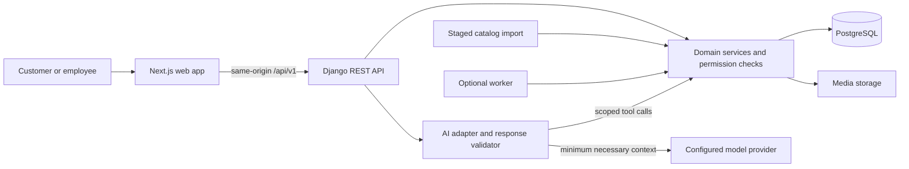

# Proposed architecture

Status: proposed design, not implemented. Phase 0 freezes decisions before code.

## System



Next.js renders routes and interaction. Django alone enforces commercial rules. A same-origin gateway/reverse proxy routes API traffic to Django; Next.js server fetches forward only the necessary authenticated context and never cache private data across users. Session cookies are HttpOnly and secure in production; validate CSRF on unsafe requests, including login. Final proxy/cookie details belong to P1.

One Postgres database supports the modular monolith. Start with deterministic exact/full-text/trigram search; add pgvector only after measured recall needs and compatibility filters are preserved. Introduce Celery/Redis only for actual background workloads. Initial local imports may be explicit management commands. Reservation expiry correctness cannot depend solely on a periodic worker.

The application's AI uses one adapter and narrow tools. Claude Code specialists are development tools and are not runtime services.

## Proposed repository layout

```text
apps/
  api/
    config/                  # Django settings, URLs, ASGI/WSGI
    accounts/                # users and roles
    organizations/           # organization, branch, memberships
    catalog/                 # product, variant, attributes and provenance
    pricing/                 # authoritative prices and tax configuration
    inventory/               # balances, reservations, movements
    quotations/              # requests, immutable issued versions
    sales/                   # operational orders and complete fulfillment
    ingestion/               # staging, normalization and reports
    ai/                      # provider adapter, tools, policy, evaluations
    audit/                   # append-only business event services
    tests/
  web/
    src/app/                 # routes and layouts
    src/features/            # catalog, inventory, quotations, sales, ai
    src/components/ui/       # shared accessible primitives
    src/lib/                 # transport and shared utilities
packages/
  api-client/                # generated/validated TS client; no business rules
contracts/
  openapi.yaml               # exported from DRF after implementation
tests/
  e2e/
  fixtures/                  # explicit synthetic records only
infra/
  local/                     # local runtime support
compose.yaml
docs/
.claude/
```

These application paths are targets; they do not yet exist. Do not generate empty Django apps merely to match the tree. Warehouse starts as a bounded service in sales/inventory; logistics gets a separate app only when approved.

## Data ownership

| Domain | Principal entities | Exclusive authority |
| --- | --- | --- |
| accounts/organizations | User, RoleAssignment, Organization, Branch, BranchMembership | Identity and scope |
| catalog | Product, Variant/SKU, Brand, Category, AttributeValue, Media, SourceReference | Product identity/specifications |
| pricing | PriceList, PriceEntry, TaxRule | Versioned authoritative monetary values |
| inventory | StockLocation, Balance, Movement, Reservation/Line | Availability and physical stock |
| quotations | Quote, QuoteVersion, QuoteLine | Issued immutable commercial offer |
| sales | Order, OrderLine, Fulfillment | Operational commitment and delivery from stock |
| ingestion | ImportJob, StagedRecord, ValidationIssue | Untrusted source staging; never live balances |
| ai | Conversation, ToolEvidence, PolicyResult | Conversation references; no commercial authority |
| audit | BusinessEvent | Actor, reason, scope, correlation and event history |

All business entities carry organization ownership directly or through enforced parent relationships. Unique SKU scope, branch membership and same-organization foreign-key checks are service and database concerns. Cross-app imports go through services/selectors; do not scatter mutations across signals or serializers.

## Frontend route plan

| Proposed route | Audience / behavior | Phase |
| --- | --- | --- |
| /, /catalog, /catalog/[sku] | Published catalog and branch selector | P1/P2 |
| /login, /account | Session and own profile | P1 |
| /quotes, /quotes/[id] | Customer's own quotations | P3 |
| /staff/catalog, /staff/quotes | Sales workspace | P3 |
| /staff/orders, /staff/orders/[id] | Authorized order workflow | P3 |
| /staff/inventory | Branch inventory and permitted adjustments | P3 |
| /staff/warehouse | Pick and fulfill assigned branch orders | P3/P5 |
| /assistant | Customer/employee appropriate AI | P4 |
| /manage/staff, /manage/audit | Scoped management | P5 |
| /manage/deliveries, /driver/deliveries | Optional logistics; not scaffolded in MVP | P6 |

Prefer server components for read-heavy public views. Client components own interaction. API state stays in the chosen server-fetch/query mechanism; local filters, dialogs and unsaved inputs stay component state. Do not introduce a global state library without a demonstrated need. Plan responsive image cards, field-level redaction and loading/empty/UNKNOWN/stale/unauthorized/error states. Use semantic HTML, keyboard support and visible focus.
